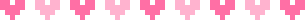
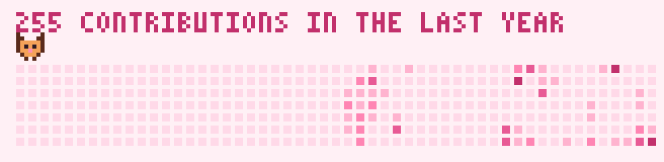

  

  

### ▸ about me

- BSIT student from the Philippines (she/her)
- currently learning full-stack web development and AI-assisted apps
- fun fact: my avatar is a cat on a laptop, and so is my banner

### ▸ featured projects

**[RescueEye](https://github.com/SamoneSamwhere/RescueEye)** — an AI-assisted disaster response platform. Drone footage is analysed for possible casualties and damage, and the nearest responders are dispatched. Capstone project, built as a team of four.

   

**[CampusGear](https://github.com/SamoneSamwhere/CampusGear)** — a web system for reserving and borrowing school equipment. Students check availability and track items; custodians manage requests, returns and equipment condition.

 

### ▸ skills

**languages** &nbsp;

**frameworks** &nbsp;

**tools** &nbsp;

### ▸ stats

  

  

### ▸ say hi

  
  

